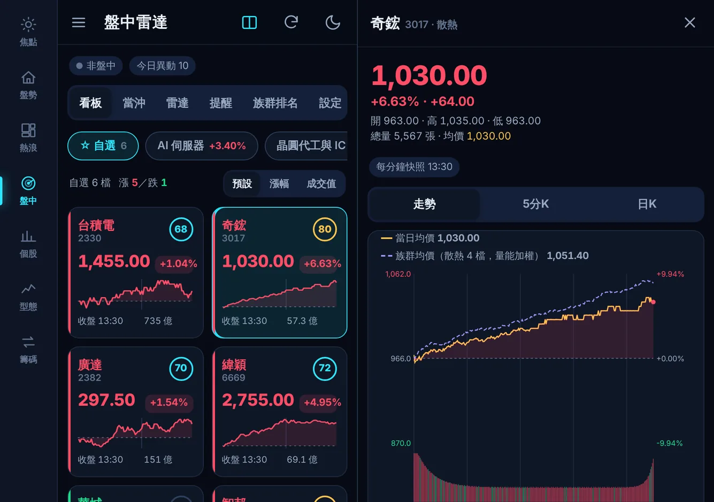
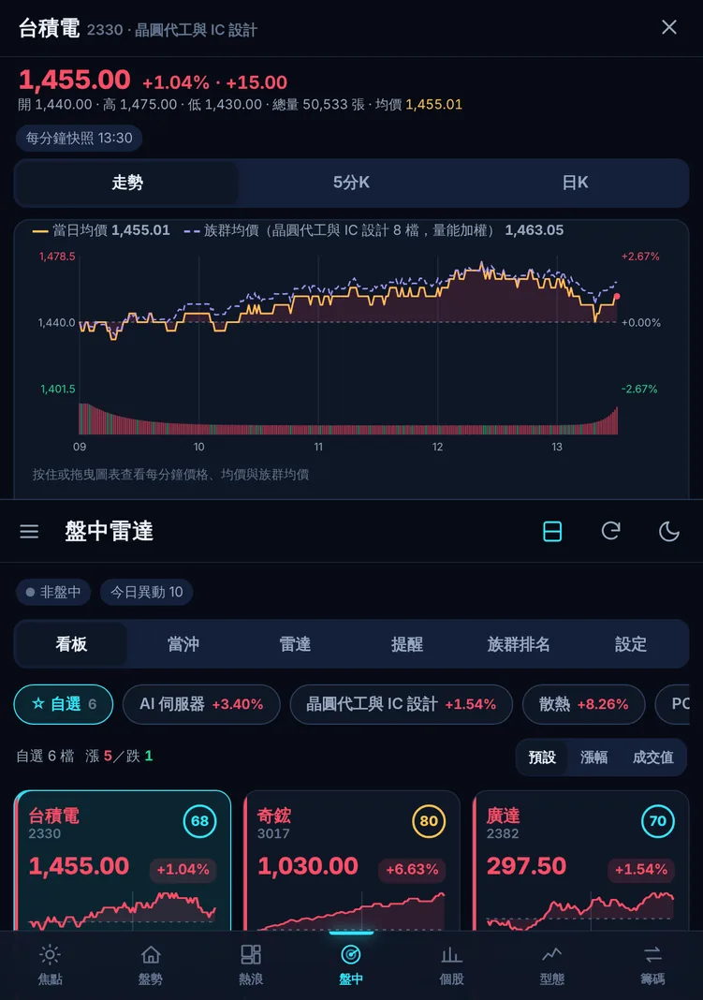
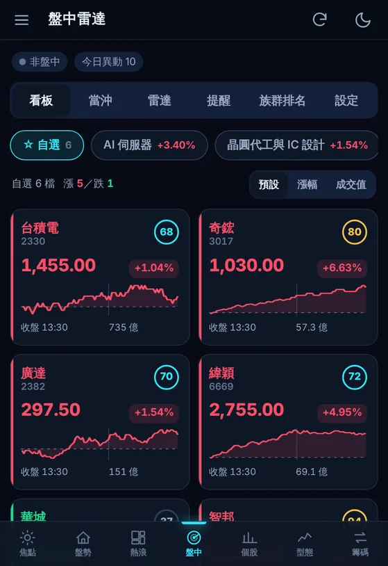
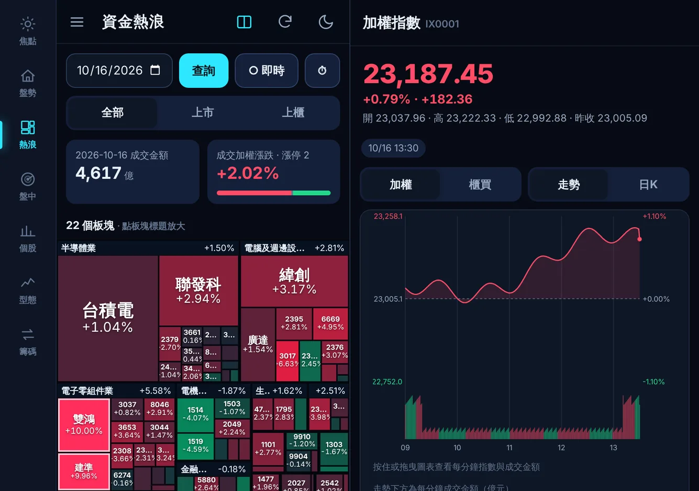

# 摺疊手機與平板（雙頁版面）

衡析 Pocket 依螢幕形狀自動換版面，一般手機、摺疊手機的封面與展開螢幕、平板與橫向手機都適用。摺疊手機（例如 iPhone Duo、Galaxy Z Fold）展開後螢幕接近一台小平板，摺痕剛好把畫面分成兩半。衡析把兩半當成兩頁：一頁放清單，另一頁放你正在看的股票，不必開關視窗。

## 摺疊手機帶來的好處

| 好處 | 說明 |
|---|---|
| **清單與走勢並排** | 點看板、當沖名單、雷達、熱浪圖或任何清單中的股票，另一頁立即顯示它的走勢、5 分 K、日 K、五檔與成交明細。清單照常更新，可以一檔一檔往下看 |
| **大盤常駐** | 沒有開啟股票時，副頁顯示加權指數走勢，可切換櫃買指數或日 K，隨時對照大盤 |
| **看盤架** | 直向展開，或半摺立在桌上時，上頁是走勢，下頁是清單與分頁列。搭配「螢幕恆亮」，可以不用手拿著看盤 |
| **摺起來照常用** | 封面螢幕維持熟悉的單頁版面，上下列精簡，多留空間給內容；推播照常收到 |
| **無縫切換** | 在封面螢幕開著一檔股票時展開手機，這檔會移到副頁繼續更新；摺起來時回到從下方滑出的視窗 |
| **更大的熱浪圖與更多 K 棒** | 副頁收合時清單用全寬；走勢與 K 線依副頁寬度畫出更多 K 棒 |

## 三種版面

| 版面 | 什麼時候（自動） | 排列 |
|---|---|---|
| **單頁** | 寬度小於 600px，例如一般手機或 iPhone Duo 的封面螢幕（約 466 × 678）；或放不下兩頁時 | 底部分頁列；點股票從下方滑出視窗 |
| **左右雙頁** | 寬度至少 712px，且畫面是橫向或寬度已有 712px。例如 iPhone Duo 展開（橫向約 890 × 626）、Galaxy Z Fold 展開、平板、橫向手機 | 左頁：側邊分頁列＋清單；右頁：副頁 |
| **上下雙頁** | 直向、寬度 600–711px、高度至少 640px。例如 iPhone Duo 展開後轉成直向（約 626 × 890）；或瀏覽器回報水平摺痕（半摺立在桌上） | 上頁：副頁；下頁：清單＋底部分頁列 |

上表的 iPhone Duo 尺寸是依 Apple 公布的解析度推算，以 3 倍像素密度換成 CSS 像素，實機可能略有差異。衡析依實際寬高判斷，不看機型。

### 分頁位置

- **左右雙頁**：分在畫面正中央，也就是摺痕位置。左頁至少保留側邊分頁列 72px 加清單 340px，副頁至少 300px；例如 Galaxy Z Fold（約 750px 寬）左頁 412px、副頁 338px。
- **上下雙頁**：上頁占一半高度。上頁的走勢圖高度限制在上頁可用範圍內，立在桌上時不必捲動就看得到整張走勢。
- **依摺痕分頁**：瀏覽器支援 Viewport Segments API 時（Android Chrome 138 起），依實際摺痕位置與遮罩寬度分頁，內容不會跨過摺痕。
  - 摺痕直立（書本式半摺）時左右分頁；摺痕水平（桌上半摺）時上下分頁。
  - iPhone Safari 沒有這個 API，依寬高判斷。

## 怎麼用

- **看股票**：點清單中的股票，副頁換成它的走勢；左頁會標示正在看的那一檔。
- **回到大盤**：按副頁右上角 ✕，或按手機的返回鍵。
- **收合副頁**：按上方的雙頁按鈕（▯），清單改用全寬，適合看熱浪圖或長表格。再按一次，或點任何股票，就會重新展開。
- **熱浪圖**：雙頁時點個股方塊，直接在副頁開走勢；點板塊標題仍是放大板塊。
- **其他視窗**：個股診斷、型態明細、大盤指數與設定也都在副頁開啟。

## 設定

在左上角 ☰ 設定的「版面」選擇：

| 選項 | 說明 |
|---|---|
| 自動（預設） | 依上面「三種版面」的條件判斷 |
| 左右雙頁 | 寬度至少 712px 時一律左右分頁；放不下時改用自動 |
| 上下雙頁 | 高度至少 640px 時一律上下分頁（一般手機也可以）；放不下時改用自動 |
| 單頁 | 永遠使用單頁 |

- 下方「目前」顯示正在使用的版面、畫面寬高與原因，例如「左右雙頁（890 × 626，依畫面寬高）」。
- 版面設定與副頁收合狀態存在這支手機的瀏覽器（`pocket.layout`、`pocket.pane`），不影響其他裝置。

## 運作方式

- `layout.js` 依畫面寬高、摺痕與設定決定版面，標在 `<html data-layout="phone|split|stack" data-pane="on|off">`，並算出左頁寬、上頁高與摺痕寬度給 CSS 使用。
- 副頁就是單頁時從下方滑出的個股視窗：
  - 單頁時，視窗蓋住清單，清單暫停重畫。
  - 雙頁時，視窗停靠在副頁。看板、當沖名單、雷達與熱浪圖照常依原本頻率更新：即時推播時每 3 秒，否則每 10 秒。
- 摺起、展開或旋轉時，約 0.1 秒後重新判斷版面：
  - 正在看的股票保留，走勢圖依新的寬度重畫。
  - 歷史紀錄不變，返回鍵的行為一致。
- 短螢幕（高度 720px 以下，例如封面螢幕）的單頁版面：上方標題列 48px、底部分頁列 54px（一般為 56px、62px）。
- 加入主畫面的 App 不再鎖定直向（manifest `orientation: any`），展開的摺疊手機可以橫向使用。

## 資料來源與請求量

| 資料 | 來源 | 請求量 |
|---|---|---|
| 副頁的個股走勢、五檔、成交明細 | 與原本的個股視窗相同 | 不變；副頁顯示時才更新 |
| 副頁閒置時的大盤走勢 | 與「盤勢 → 大盤指數」相同（Nexus 向富果取指數報價與 1 分 K） | 盤中每 30 秒 1 次；每次向富果 2 個請求，Nexus 快取 5 秒。自己開啟指數時每 10 秒；副頁收合或改看個股時停止 |

## 注意事項

- **iPhone 無法自動偵測半摺**：iOS Safari 不支援摺痕 API，直向展開時會自動上下分頁；其他情況可在設定選「上下雙頁」。
- **Split View**：iPhone Duo 兩個 App 並排時，衡析只有一半寬度，會使用單頁。
- **左頁較窄時**：例如 Galaxy Z Fold，看板卡片的價格與漲跌改為上下排列。
- **已加入主畫面的 Android App**：可能要等 Chrome 更新 App 資訊後才會解除直向鎖定；想立即生效可以從主畫面移除後重新加入。iPhone 不受影響。

## 相關檔案

- 程式：
  - `EquiLens-Pocket/public/layout.js`（版面判斷、摺痕偵測、設定）
  - `public/app.js`（副頁停靠、選取標示、版面切換）
  - `public/live.js`（副頁閒置的大盤走勢、圖表尺寸）
  - `public/app.css`（檔尾的雙頁樣式與容器查詢）
  - `public/manifest.webmanifest`
- 測試：`EquiLens-Pocket/tests/layout.test.mjs`。
- 截圖：`EquiLens-Nexus/tools/screenshots/capture.mjs` 的 `foldable`。
