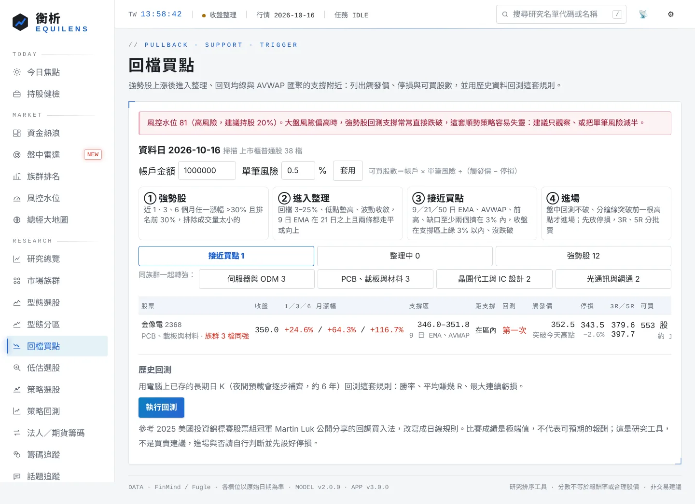

# 回檔買點

找出「強勢股上漲後進入整理、回到支撐附近」的股票，列出觸發價、停損、3R／5R 價位與可買股數，並用電腦上已存的歷史資料回測這套規則。規則參考 2025 美國投資錦標賽股票組冠軍 Martin Luk 公開分享的回調買入法，改寫成日線能判斷的條件。

比賽成績是極端值，不代表可預期的報酬。這是研究工具，不是買賣建議；衡析不會下單，進場與否請自行判斷並先設好停損。

## 在哪裡

電腦版左側「研究」→「回檔買點」（台股、美股）。點股票名稱開啟 K 線視窗。

## 怎麼用

1. 先看最上面的風控水位提醒。風險偏高（偏高、高風險）時，強勢股回測支撐常常直接跌破，建議只觀察或把單筆風險減半。
2. 「接近買點」分頁：今天收盤已回到支撐區附近的股票。每檔有觸發價（今天高點）、停損、3R／5R 價位與可買股數。
3. 「整理中」：已經是強勢股、正在整理，但還沒回到支撐，或還差某個條件（表格寫出還差什麼），可以先放進觀察。
4. 「強勢股」：只通過第一關的全部名單，以及沒有進入下一關的原因。
5. 「同族群一起轉強」：同族群有 2 檔以上是強勢股時列出，點族群只看該族群。
6. 在「帳戶金額」「單筆風險」填入自己的數字，可買股數會換算好（只存在這台電腦的瀏覽器）。
7. 隔天盤中，股價回測支撐不破、分鐘線突破前一根 K 高點時才考慮進場，進場後立刻放停損。

## 規則

| 關卡 | 條件 |
|---|---|
| ① 強勢股 | 近 1、3、6 個月（21、63、126 個交易日）任一漲幅 ≥ 30%，且該期間漲幅排名在前 30%；近 20 日平均成交量 ≥ 50 萬股（台股 500 張） |
| ② 進入整理 | 近 40 日最高點之後至少整理 3 天；自高點回檔 3%～25%；高點後的轉折低點一次比一次高；近 5 日平均振幅 ≤ 高點前後 10 日的 90%（波動收斂）；9 日 EMA 在 21 日 EMA 之上、收盤守住 21 日 EMA（容許 1%）；9 日 EMA 走平或向上（3 日內跌幅 ≤ 0.5%）、21 日 EMA 走平或向上（5 日內跌幅 ≤ 0.3%） |
| ③ 接近買點 | 支撐價位：9／21／50 日 EMA、AVWAP（從整理區高點那天起算的成交量加權均價）、前高（高點之前 120 日內的轉折高點）、未補缺口（近 60 日向上跳空且沒回補）。現價下方 12% 以內、至少兩種價位擠在 3% 以內算支撐區；收盤在支撐區上緣 3% 以內、當天沒有跌破支撐區下緣 1%；停損距離 ≤ 8% |
| 回測次數 | 高點之後最低價碰到支撐區上緣的次數（連續幾天算一次）。Martin 特別看重第一次回測 |

交易計畫：

| 項目 | 算法 |
|---|---|
| 觸發價 | 今天最高價（隔天突破才進場；日線看不到分鐘線訊號，用這個近似） |
| 停損 | 今天最低價與支撐區下緣較低者，再低 0.3% |
| 1R | 觸發價 − 停損 |
| 3R／5R | 觸發價 + 3R／5R，Martin 常在這附近分批賣出 |
| 可買股數 | 帳戶金額 × 單筆風險 ÷ 1R；台股換算成張，不足一張顯示零股 |

排序：接近買點 → 整理中 → 強勢股；同一關裡族群同強的在前，再依最大漲幅。

## 歷史回測

按「執行回測」，用電腦上已存的長期日 K（約 6 年）逐日套用同一套規則：

| 項目 | 規則 |
|---|---|
| 進場 | 前一天收盤符合「接近買點」，隔天最高價突破前一天高點才進場，價格取開盤價與前一天高點較高者 |
| 停損 | 前一天的停損價；跳空跌破用開盤價。進場當天就碰到停損，保守當作停損出場 |
| 出場 | 到 3R 先賣一半之前只看停損；賣一半後，剩下的收盤跌破 9 日 EMA 出場（進場點本來就靠近 9 日 EMA，一開始就用它出場會被洗掉）；最多持有 40 個交易日；回測結束時還沒出場的不計 |
| 成本 | 台股來回 0.585%（手續費 0.1425% × 2 ＋ 證交稅 0.3%），美股 0.1% |
| 部位 | 每檔同一時間最多一筆；每筆都以 1R 計，報酬換算成 R |

結果有交易次數、勝率、平均每筆 R 與中位數、獲利因子、平均賺／賠 R、依出場順序累計的最大回落、到 3R 的比例、平均持有天數與停損距離，以及三種分組：

- 依大盤寬度：進場前一天回測股票中站上 50 日 EMA 的比例，≥60% 強、40–60% 中、<40% 弱。用來看這套順勢策略是否只在多頭有效。
- 依第一次回測或第二次以上。
- 依年度。

「看最近交易」列出最近 200 筆的進出場日期、價格、結果與出場原因。結果存在 `.local/pullback/backtest.json`（美股 `.local-us/`）。

## 運作方式

- 台股：掃描全部上市櫃普通股（四位數代號，排除 ETF、權證，以及型態選股不分析的產業），日 K 用「型態選股」的全市場快照（至少 90 個交易日；6 個月漲幅需要 126 日，快照累積不足時這一欄是空的）。族群用 AI 供應鏈與同業分組，其餘用證交所產業別。
- 美股：與型態分區同一批股票（AI 供應鏈＋持股＋自選，約 100 檔），每檔約 400 天日 K。
- 橫斷面排名在掃描的股票之間計算。
- 掃描結果依資料日快取，快照或日期改變時重算。

## 資料來源與請求量

- 掃描：不另外發請求，使用型態選股快照（台股）與型態分區已抓的日 K（美股）。
- 回測：只讀電腦上的長期日 K 快取（`.local/cache/deep/long_<代號>.json`，個股河流圖、股利與[夜間預載](financials.md)會建立），不發請求。至少要 20 檔才回測；夜間預載每晚會補一批。

## 注意事項

- 回測股票是電腦上有長期資料的那些（以持股、自選、研究名單、AI 供應鏈為主），偏向現在大家關注的股票，有選股偏差；預載越多，偏差越小。
- 長期日 K 沒有還原權值，除權息的跳空可能誤觸停損或誤判缺口。
- 日線無法重現分鐘線進場與盤中停損，實際成交價會不同；跳空與滑價可能讓虧損超過 1R。
- 台股來回成本約 0.585%，停損 3% 時成本就占約兩成的 1R，停損太窄不划算。
- 台股有漲跌停 10% 的限制，跳空鎖住時無法照計畫進出。

## 相關檔案

- `EquiLens-Nexus/lib/pullback.mjs`：規則、掃描與回測（純計算）
- `EquiLens-Nexus/server.mjs`：`GET /api/pullback`、`GET`／`POST /api/pullback/backtest`
- `EquiLens-Nexus/public/pullback.js`：電腦版頁面
- `EquiLens-Nexus/tests/pullback.test.mjs`
