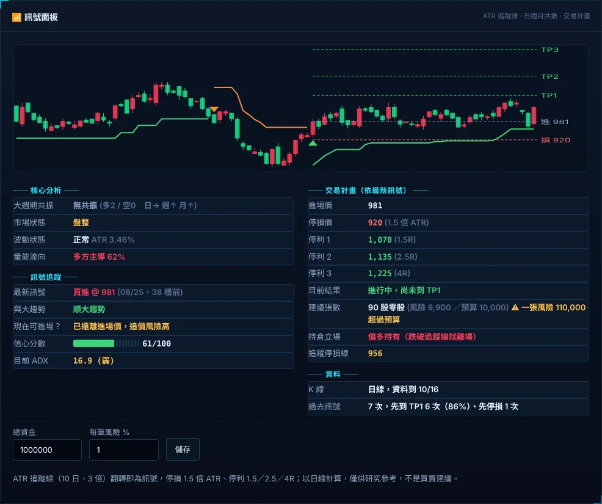

# 訊號面板

個股視窗裡的「📶 訊號面板」用日線 ATR 追蹤線（SuperTrend）翻多或翻空當作買賣訊號。面板同時整理日、週、月三個週期的趨勢共振、ADX 趨勢強度、波動與量能流向，再算出 0～100 的信心分數和交易計畫：進場價、停損、三個停利點與追蹤停損。填好總資金與每筆風險後，會換算建議張數。自選股收盤後出現新訊號時會推播到手機。台股與美股都能用。

> 訊號是依固定規則算出的研究紀錄，不是買賣建議。過去訊號的統計只反映這檔股票在資料期間內的表現，不代表未來。

## 在哪裡

- **電腦版**：點任何股票開啟 K 線視窗，切到右上角的「訊號」分頁（與走勢、5分K、日K 並列），任何股票都能看。研究名單內的股票，「個股診斷」視窗的「🧭 個股判讀」下方也有同樣的面板。面板底部可以設定資金與每筆風險。
- **手機版**：個股頁的「📶 訊號面板」卡片，只能查看。資金與風險要在電腦版設定。
- **推播**：自選股的新訊號以「📶 名稱 代號 買進訊號／賣出訊號」推播，點開進入「盤中」分頁。

## 內容

最上方是近 90 根日 K，疊上追蹤線（多方段綠色、空方段橘色）、訊號點（▲ 翻多、▼ 翻空）以及最新訊號的進場、停損和停利虛線。

| 區塊 | 項目 | 說明 |
|---|---|---|
| 核心分析 | 大週期共振 | 日（20 日均線）、週（13 週均線）、月（6 個月均線）各自判斷趨勢。收盤在指數均線之上而且均線比 3 根前高，算「多」；收盤在均線之下而且均線比 3 根前低，算「空」；其餘算中性。全部同向為「多方共振」或「空方共振」，否則為「無共振」，並列出多、空各有幾個週期 |
| | 市場狀態 | ADX ≥ 30 為強勢趨勢，20～30 為趨勢中，低於 20 為盤整 |
| | 波動狀態 | ATR ÷ 股價在近 120 日的百分位：80 以上偏高，20 以下偏低，其餘正常 |
| | 量能流向 | 近 20 日上漲日成交量占比：55% 以上多方主導，45% 以下空方主導，其餘多空均衡 |
| 訊號追蹤 | 最新訊號 | 最近一次追蹤線翻轉：方向、當天收盤價，以及距今幾根 K 棒 |
| | 與大趨勢 | 訊號方向與週線趨勢相同為「順大趨勢」，相反為「逆大趨勢」 |
| | 現在可進場？ | 見下表 |
| | 信心分數 | 見「運作方式」 |
| | 目前 ADX | 14 日 ADX，30 以上為強、20～30 為中、低於 20 為弱 |
| 交易計畫 | 進場價 | 訊號當天收盤價 |
| | 停損價 | 進場價 ∓ 1.5 倍 ATR（14 日），依跳動單位取整 |
| | 停利 1／2／3 | 進場價 ± 1.5R、2.5R、4R（R＝進場到停損的距離），已觸及的打勾 |
| | 目前結果 | 進行中、已到 TP n、目標達成或已停損。同一根 K 棒同時碰到停損和停利時，保守以停損計 |
| | 建議張數 | 見「設定」 |
| | 持倉立場 | 追蹤線在價格下方為「偏多持有（跌破追蹤線就離場）」，在上方為「偏空，避開或減碼」 |
| | 追蹤停損線 | 目前的追蹤線價位 |
| 資料 | K 線 | 資料到哪一天。盤中以即時報價暫代今天的 K 棒，並標示「暫定」 |
| | 過去訊號 | 資料期間內先前每次訊號，在下一次翻轉前先到 TP1 或先停損的次數 |

「現在可進場？」的判斷：

| 條件 | 顯示 |
|---|---|
| 已停損 | 已停損，等待新訊號 |
| 已到 TP1，或價格已朝訊號方向走了 0.75R 以上 | 已遠離進場價，追價風險高 |
| 價格往停損方向走了 0.5R 以上 | 接近停損，暫不進場 |
| 訊號在 5 根 K 棒以內 | 訊號有效，可評估進場 |
| 其餘 | 訊號已久，等回測追蹤線 |

## 運作方式

- **追蹤線**：SuperTrend（10 日、3 倍 ATR）。中價 ± 3 倍 ATR 形成上下軌，收盤跌破下軌時翻空、突破上軌時翻多，翻轉當天就是訊號。
- **信心分數**：從 40 分開始，依序加減：
  - 週線與訊號同向 +15、反向 −15
  - 月線同向 +10、反向 −10
  - ADX 由 15 到 35 線性加 0～15 分
  - 量能流向與訊號同向最多 +10，反向最多 −10
  - 波動偏高 −5
  - 訊號每舊一根 −1，最多 −10
  - 已停損時最高 20 分

  總分限制在 0～100。
- **K 線資料**：研究名單的股票用本機日 K（與研究評分相同）。只在自選、不在研究名單的股票，向資料源取近 400 天日 K，快取 6 小時。

## 設定

在電腦版面板底部填「總資金」與「每筆風險 %」（0.1～20），按「儲存」。

- 建議部位以目前價格進場、停損仍在訊號停損價計算：每筆可承受虧損 ＝ 總資金 × 風險 %，股數 ＝ 可承受虧損 ÷ 每股風險，且總金額不超過總資金。
- 台股換算成張；不足一張的部分列為零股。一張的風險超過預算時會提醒。美股顯示股數。
- 已停損或目標已達成時不計算部位。
- 設定存在 `settings.json` 的 `signal`（`capital`、`riskPct`、`push`）。新訊號推播預設開啟。

## 推播

每次研究資料更新完成後（自動更新或手動按「更新」），掃描自選股：研究名單內的自選股全部掃描，研究名單以外的最多 60 檔。最新一根完整日 K 出現新訊號時加入提醒並推播；盤中的暫定訊號不推播。同一檔、同一天、同一方向只推一次，第一次掃描只記錄、不推播。一次超過 4 則會合併成一則。

已推播的訊號記錄在 `.local/signal-seen.json`。

## 資料來源與請求量

- 研究名單內的股票不另外查詢。
- 研究名單外的自選股，每檔每 6 小時最多 1 個日 K 請求，來源是目前的日 K 資料源。

## 注意事項

- 只有日線。台股免費資料源沒有 1 小時 K，所以「大週期」是日、週、月，不是小時線。
- 停損只有 1.5 倍 ATR，比追蹤線（3 倍 ATR）近，常在追蹤線翻轉前就先停損。請一併參考「過去訊號」的統計。
- 日 K 為未還原股價；除權息造成的跳空可能產生假訊號。
- 賣出訊號對一般現股投資人的意思是避開或減碼；停利、停損的價位以放空方向計算。

## 相關檔案

- `EquiLens-Nexus/lib/signal.mjs`：計算（純函式）
- `EquiLens-Nexus/server.mjs`：`GET /api/signal?id=`、`POST /api/signal/settings`、收盤後掃描 `scanSignals`
- `EquiLens-Nexus/public/riskvalue-ui.js`（與 Pocket 共用）：`signalHTML`、`signalChartSVG`
- `EquiLens-Nexus/public/live.js`、`EquiLens-Pocket/public/live.js`：個股視窗區塊
- `EquiLens-Pocket/lib/push.mjs`：推播文字
- `EquiLens-Nexus/tests/signal.test.mjs`
