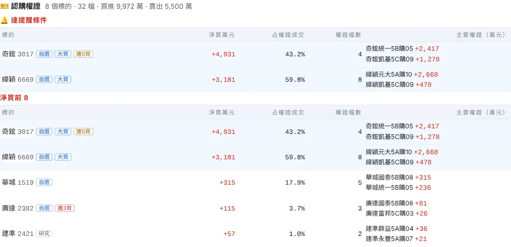
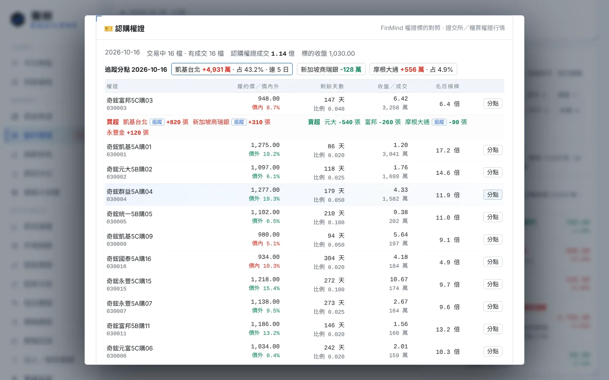
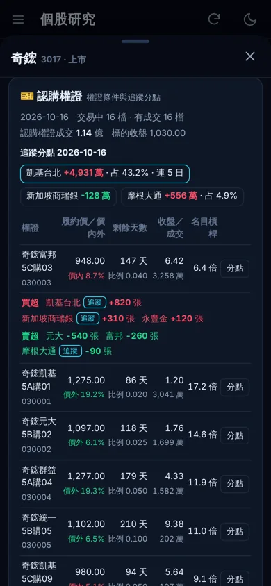

# 權證追蹤（認購權證）

追蹤你關注的券商分點在**認購權證**上的進出，依標的股彙總成「這個分點今天買了哪些股票的認購權證、金額多少」。出現單日大買或連續買進時，會和分點追蹤一起推播。另外在個股視窗列出該股所有交易中的認購權證，以及這些權證的分點進出。

主力常用權證放大槓桿，所以分點在權證上的動向常被當成籌碼線索。但這只是研究紀錄，不代表主力的真實意圖，也不是買賣建議。

## 在哪裡

| 位置 | 內容 |
|---|---|
| 電腦版「籌碼追蹤 → 分點追蹤」 | 每個分點的報告下方多一段「🎫 認購權證」：達提醒條件、淨買前 8 名 |
| 電腦版個股視窗 → 個股診斷 | 「🎫 認購權證」面板：這檔股票的認購權證清單、追蹤分點的進出，每檔可查分點 |
| 手機版「籌碼 → 分點追蹤」 | 同電腦版 |
| 手機版個股頁 | 「🎫 認購權證」卡片 |
| 推播 | 併在分點追蹤的推播裡，例如「認購權證：奇鋐（自選） 淨買 1,206 萬（占 15.2%），連 3 日 +2,000 萬」 |

需要 FinMind Sponsor 方案（權證分點與權證標的對照表都是 Sponsor 資料）。

## 怎麼運作

1. **權證標的對照**：每天第一次需要時，向 FinMind 取一次權證標的對照表，內容包括權證代號、標的、類型、上市日、最後交易日、行使比例與履約價。
   - 同一個權證代號到期後會重新發給其他標的，所以依「日期落在上市日～最後交易日」判斷當天對應哪一檔。
   - 取不到時沿用上次的對照表，並標示為舊資料。
2. **認購權證行情**（免金鑰）：每個交易日各取一次證交所與櫃買中心的權證收盤行情，包括名稱、收盤、成交量與成交金額，用來計算每檔標的當日的認購權證成交金額。
   - 上市：證交所每日收盤行情的「認購權證」類（不含牛證）。
   - 上櫃：櫃買中心權證收盤行情，只有最新一個交易日；日期不符時不採用。
   - 只取到其中一邊時，30 分鐘後再試。
3. **分點的權證進出**：查分點追蹤時，每個追蹤分點多查一次它當天的權證分點資料，然後：
   - 只留認購權證；認售權證、牛熊證、對照表找不到的代號不列入。
   - **排除發行商自家的造市**：從權證名稱推出發行商（例如「奇鋐凱基56購01」的發行商是凱基）。分點名稱與發行商簡稱相同時，代表是發行券商的總公司，含自營部的造市與避險，這些權證的進出不列入。發行券商的一般分點照常計算。
   - 依標的彙總：淨買金額＝買進單位數 × 成交價 − 賣出單位數 × 成交價。
   - **占權證成交**＝淨買金額 ÷ 該標的當日認購權證成交金額，只對淨買超計算。
   - **連續天數**：連續淨買的交易日數（含今日）與這段期間的累計淨買金額，以本機保存的分點追蹤紀錄計算。

## 提醒條件

| 提醒 | 預設條件 |
|---|---|
| **權證大買** | 單日淨買 ≥ 500 萬元，**且**占該標的當日認購權證成交 ≥ 10%（行情取不到時只看金額） |
| **連續買進** | 連 3 個交易日（含今日）淨買，**且**這幾日累計淨買 ≥ 500 萬元 |

- 只看淨買，淨賣不提醒。連續買進另加累計金額門檻（與單日金額相同），避免每天只買一點也觸發。
- 門檻在「籌碼追蹤 → 分點追蹤」的「認購權證」列調整：

  | 項目 | 選項 |
  |---|---|
  | 金額 | 100 萬／300 萬／500 萬／1,000 萬／3,000 萬 |
  | 占比 | 5／10／20／30% |
  | 連續天數 | 2／3／5 日 |

- 取消勾選「一起查詢」就不查權證，每個分點也不會多用請求。
- 推播：每個分點一則（和股票的單日主導、多日吃貨合併），自選與研究名單的標的排在前面，每則最多列 5 檔。

## 個股的認購權證面板

| 欄位 | 內容 |
|---|---|
| 權證 | 名稱與代號 |
| 履約價／價內外 | 價內外＝標的收盤 ÷ 履約價 − 1；履約價缺值時顯示「—」 |
| 剩餘天數 | 到最後交易日的日曆天數；下方是行使比例（每 1 單位權證可換的標的股數） |
| 收盤／成交 | 權證收盤價與當日成交金額 |
| 名目槓桿 | 標的收盤 × 行使比例 ÷ 權證收盤；未考慮 Delta，只供比較 |
| 分點 | 查詢這檔權證當天的分點買超、賣超前 8 名，你追蹤的分點會標示 |

- 只列交易中的認購權證，依當日成交金額排序，最多 40 檔。
- 上方「追蹤分點」列出最近一次分點追蹤紀錄中，有買賣這檔股票認購權證的分點。
- 清單日期是最新交易日（15:00 後算當天）；「分點」查的是 18:30 後已公布的最新交易日。

手機版：

## 資料來源與請求量

| 資料 | 來源 | 請求量 |
|---|---|---|
| 權證標的對照（全市場） | FinMind `TaiwanStockInfoWithWarrantSummary` | 每天 1 次，約 1 分鐘 |
| 分點的權證進出 | FinMind `taiwan_stock_warrant_trading_daily_report`（依券商代碼） | 每個追蹤分點每天 1 次 |
| 認購權證行情 | 證交所每日收盤行情 type=0999、櫃買 `tpex_warrant_daily_quts` | 每個交易日各 1 次，免金鑰 |
| 個股的權證清單 | FinMind 權證標的對照（依標的查詢） | 每檔 12 小時最多 1 次 |
| 單一權證的分點 | FinMind 權證分點（依權證代號） | 按「分點」時每檔每日 1 次，查過的保存 |

追蹤 20 個分點時，每天約多 21 次 FinMind 請求，另加 2 次官方開放資料。

## 注意事項

- **只看認購權證**：認售權證、牛熊證都不列入。
- **發行商是從名稱推算**：取權證名稱中標的簡稱之後、代碼之前的文字。名稱格式特殊時可能判斷錯，被排除的檔數會顯示在「不含發行商總公司 N 檔」。
- **資料品質待確認**：FinMind 文件範例中的履約價與收盤是 0，實際資料缺值時價內外與槓桿顯示「—」。行使比例若以「每千單位」表示，會自動換算成每 1 單位。
- **證交所可能封鎖部分網路**：證交所網站會擋部分海外與雲端網路，家用網路通常正常。取不到上市權證行情時，「占權證成交」不判斷，權證大買只看金額，頁面會註明。
- **查過去日期時，上櫃權證沒有成交資料**：櫃買行情只提供最新一個交易日。
- **權證風險**：權證有時間價值遞減，槓桿高，流動性可能不足；畫面上的資料只供研究。

## 相關檔案

- 程式：`EquiLens-Nexus/lib/warrants.mjs`（對照、行情解析、發行商判斷、分點彙總、個股清單）、`lib/chipwatch.mjs`（提醒與設定）、`lib/providers/twse.mjs`（`callWarrantQuotes`）、`server.mjs`、`public/insight-ui.js`。
- 資料：
  - `.local/warrants/master.json`（對照表）
  - `quotes-<日期>.json`（行情）
  - `by-<代號>.json`（個股清單）
  - `br-<權證>-<日期>.json`（單一權證的分點）
  - 行情與單一權證分點保留 40 天；分點的權證進出存在 `.local/broker-watch/<日期>.json`。
- API：
  - `GET /api/warrants?id=`
  - `GET /api/warrants/brokers?wid=&date=`
  - `POST /api/chipwatch/settings`：設定欄位 `warrants`、`warrantAmount`、`warrantPct`、`warrantDays`。
